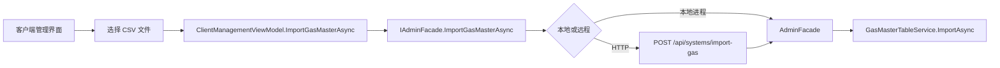
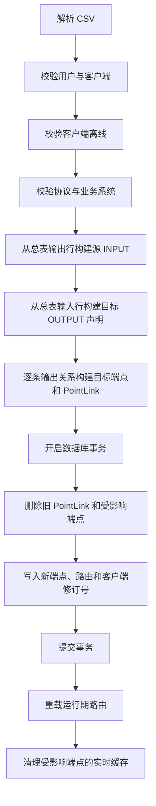

# 燃油/燃气总表导入导出逻辑

> 更新时间：2026-11-17
>
> 适用范围：`SdnCustom.Server` 系统级燃气总表导入、导出、持久化与运行期路由。
>
> 本文描述当前代码行为。历史差距分析见
> [`gas-master-table-gap-analysis.md`](gas-master-table-gap-analysis.md)。

## 1. 设计目标

燃气总表是一张跨多个数据用户的扁平路由表，而不是单个客户端的普通点表。导入器需要把它归一化为三层模型：

1. **源 INPUT 端点**：第三方系统产生、由平台接收的数据端点。
2. **目标 OUTPUT 端点**：平台向目标系统写出的数据端点。
3. **PointLink 路由**：描述哪个源 INPUT 分发到哪个目标 OUTPUT。

三者分开存储，运行期只通过 `PointLink` 建立分发关系。

## 2. 方向语义

总表中的“输入/输出”是用户或第三方程序视角，平台内部方向与其相反：

| 总表行 | 总表用户视角 | 平台端点方向 | 说明 |
|---|---|---|---|
| `测点类型=输出` | 第三方程序向外发送数据 | `INPUT` | 平台接收该数据，作为分发源 |
| `测点类型=输入` | 第三方程序等待接收数据 | `OUTPUT` | 平台向该用户写出数据 |

例如：

```text
FZXT10001-b / 主操作台急停 / 输出 / 去向=XNCZ
```

导入后生成：

```text
FZXT / FZXT10001-b / INPUT
```

如果 XNCZ 同时声明了对应目标端点，则生成：

```text
XNCZ / XNCZ10001-b / OUTPUT
```

再由一条 `PointLink` 连接：

```text
FZXT:FZXT10001-b[INPUT]
    -> XNCZ:XNCZ10001-b[OUTPUT]
```

## 3. CSV 格式

导入器要求原始模板至少包含 22 列：

| 列序号 | 列名 | 用途 |
|---:|---|---|
| 1 | 测点id | 当前用户端点 ID |
| 2 | 测点名称 | 当前端点名称 |
| 3 | 数值类型 | `bool`、`int16`、`int32`、`float32`、`double`、`string` |
| 4 | 单位 | 端点单位 |
| 5 | 用户 | 当前用户名称 |
| 6 | 用户代码 | 当前用户代码 |
| 7 | 通讯协议 | 当前端点协议：`TCP`、`OPC UA客户端`、`OPC UA服务端` |
| 8 | 测点类型 | 原始视角的 `输入` 或 `输出` |
| 9-11 | 参数1-3 | 当前端点的协议参数 |
| 12 | 数据来源用户 | 输入声明中的来源用户 |
| 13 | 数据来源用户代码 | 输入声明中的来源用户代码 |
| 14 | 数据来源用户通讯协议 | 输入声明中的来源协议 |
| 15 | 数据来源测点 | 输入声明中的来源测点名称 |
| 16 | 数据去向用户 | 输出关系中的目标用户 |
| 17 | 数据去向用户代码 | 输出关系中的目标用户代码 |
| 18 | 数据去向用户通讯协议 | 输出关系中的目标协议 |
| 19 | 数据去向测点 | 输出关系中的目标测点名称 |
| 20-22 | 参数1-3 | 输出关系中的目标协议参数 |

注意：列名 `参数1/参数2/参数3` 出现两次。解析器按列位置读取，不按列名建立字典。

### 3.1 编码与 CSV 语法

- 支持 UTF-8，兼容 BOM。
- 支持双引号字段和 `""` 转义。
- 支持字段中的逗号、换行。
- 空行会被忽略。
- 导出文件由桌面端以带 BOM 的 UTF-8 写出。

### 3.2 测点 ID 规则

测点 ID 必须满足：

```text
客户端代码 + 五位数字 + -b 或 -d
```

示例：

```text
FZXT10001-b
XNCZ10038-d
```

目标 OUTPUT 的 ID 通过替换客户端代码生成：

```text
源：FZXT10001-b
目标用户代码：XNCZ
目标：XNCZ10001-b
```

## 4. 持久化模型

### 4.1 端点：`point_catalog`

主键：

```text
(ClientCode, PointId, Direction)
```

关键字段：

| 字段 | 说明 |
|---|---|
| `ClientCode` | 端点所属客户端 |
| `PointId` | 测点 ID |
| `PointName` | 用户视角下的端点名称 |
| `Direction` | 平台方向：`Input` 或 `Output` |
| `Protocol` | TCP 或 OPC UA 协议 |
| `Address` | 归一化后的 OPC UA NodeId；TCP 通常为空 |
| `OpcUaParameter1-3` | 原始协议参数，供导出还原 |
| `DataType` / `Unit` | 类型和单位 |

同一客户端允许拥有同名 ID 的两个方向端点，例如：

```text
FZXT:FZXT10001-b:Input
FZXT:FZXT10001-b:Output
```

它们不是同一个端点。

### 4.2 路由：`point_link`

主键：

```text
LinkId
```

主要字段：

| 字段 | 说明 |
|---|---|
| `SystemCode` | 所属业务系统 |
| `Declaration` | 当前导入统一使用 `Output`，表示一条 INPUT→OUTPUT 路由 |
| `SourceClientCode` / `SourcePointId` | 源 INPUT |
| `TargetClientCode` / `TargetPointId` | 目标 OUTPUT |
| `Enabled` | 两端地址能力均满足时为 `true` |

`LinkId` 是对系统、源端点、目标端点等字段计算出的稳定 SHA-256 前缀 ID。

## 5. 导入入口链路



界面入口：

- `ClientManagementWindow` 使用文件选择器打开 `*.csv`。
- 导入目标由当前选中的业务系统决定。
- 导入完成后重新加载客户端、端点和路由。

HTTP 请求模型：

```json
{
  "systemCode": "FUEL",
  "systemName": "燃油系统",
  "csv": "...完整 CSV 文本..."
}
```

## 6. 导入处理流程



### 6.1 解析与基础校验

解析器检查：

- CSV 非空。
- 列数至少为 22。
- 第 1 列为 `测点id`。
- 第 8 列为 `测点类型`。
- 第 19 列为 `数据去向测点`。
- 每行 `测点类型` 只能是 `输入` 或 `输出`。
- 每行必须有测点 ID 和用户代码。
- 测点 ID 必须符合客户端代码加后缀规则。
- `输出` 行必须有目标用户代码和目标测点名称。

任何一项失败都会在写入数据库前终止导入。

### 6.2 客户端预检

从全部行中收集参与用户：

- `输入` 行涉及当前用户和来源用户。
- `输出` 行涉及当前用户和目标用户。

所有参与客户端必须：

1. 已在系统中登记。
2. 属于本次导入的业务系统。
3. 当前不在线且 `DesiredRunning=false`。
4. 配置协议与总表一致。

导入器**不会自动创建客户端**。

### 6.3 构建源 INPUT 端点

遍历 `测点类型=输出` 的行，按：

```text
(用户代码, 测点id)
```

分组。

每组生成一个 `Input` 端点：

- 所属客户端取当前行的用户代码。
- 名称、类型、单位取当前行。
- 协议和地址参数取当前行自己的第 7-11 列。
- 不取来源用户或目标用户协议。

这一步解决“TCP 客户端拿到 OPC UA 地址”的归属错误。

### 6.4 构建目标 OUTPUT 声明

遍历 `测点类型=输入` 的行，按：

```text
(用户代码, 测点id)
```

分组，形成目标 OUTPUT 声明字典。

这些声明是目标端点的权威元数据来源：

- 目标名称。
- 目标协议。
- 目标参数和 NodeId。
- 数据类型和单位。

### 6.5 构建 PointLink

逐条处理 `测点类型=输出` 的关系行：

1. 从源 `(用户代码, 测点id)` 找到源 INPUT。
2. 保留源 ID 后缀，替换为目标用户代码，得到目标 PointId。
3. 优先使用目标用户自己的 `输入` 声明端点。
4. 如果目标用户没有该端点的输入声明，则从当前输出行的 `数据去向` 字段生成回退端点。

回退端点主要用于目标型用户，例如样例中的 `SWGZ`。

生成的 `PointLink`：

```text
SourceClientCode = 当前输出行用户代码
SourcePointId    = 当前输出行测点 ID
TargetClientCode = 数据去向用户代码
TargetPointId    = 目标客户端代码 + 原 ID 后缀
Declaration      = Output
```

### 6.6 路由启用条件

一条路由需要同时满足：

- 源 INPUT 地址状态为 `supported` 或 `not-applicable`。
- 目标 OUTPUT 地址状态为 `supported` 或 `not-applicable`。
- 同一目标端点没有出现冲突地址。

地址状态：

| 协议/参数 | 状态 | Address |
|---|---|---|
| TCP | `not-applicable` | 空 |
| OPC UA 字符串 NodeId：`1,S,Point_B` | `supported` | `ns=1;s=Point_B` |
| OPC UA 仅数字参数 | `unsupported-numeric` | 空，路由禁用 |
| OPC UA 参数缺失 | `missing` | 空，路由禁用 |

当前客户端运行链路对数字型 OPC UA NodeId 尚无完整支持，因此只产生警告并禁用相关路由。

### 6.7 重复与冲突

- 相同 `LinkId` 的重复关系会被忽略并产生警告。
- 回退目标端点使用同一 ID 但出现多个地址时，相关路由禁用并产生警告。
- 目标用户存在自己的输入声明时，以声明端点为权威，不从输出行覆盖名称或地址。

## 7. 数据替换与事务

导入是**系统级全量替换**，不是增量合并。

在事务中执行：

1. 创建或更新业务系统。
2. 删除该系统下全部 `Declaration=Output` 的 PointLink。
3. 删除本次参与客户端已有的全部端点。
4. 写入新的 INPUT、OUTPUT 端点。
5. 写入新的 PointLink。
6. 更新参与客户端的 `PointsConfigured`、`CatalogRevision`、`LastSeen`。
7. 提交事务。

提交成功后：

1. 调用 `PointLinkCatalog.ReloadAsync()` 重建运行期路由。
2. 删除受影响客户端的旧实时值缓存。

数据库失败会回滚端点和路由变更。

注意：路由重载和缓存清理发生在数据库事务提交之后。如果这两步失败，数据库已经更新，
但运行期路由或实时缓存可能尚未同步；此时应查看服务端日志并重启或重新加载服务。

## 8. 导入结果

接口返回：

```text
SystemCode
ClientCount
InputCount
OutputCount
RouteCount
Warnings
```

当前内置样例的预期结果：

| 项目 | 数量 |
|---|---:|
| 客户端 | 5 |
| 源 INPUT 端点 | 200 |
| 目标 OUTPUT 端点 | 192 |
| PointLink 路由 | 366 |
| 启用路由 | 229 |
| 数字型 OPC UA 警告 | 18 |

原始样例总表共 732 条数据行：

- 366 条输入声明。
- 366 条输出关系。

输入声明用于端点元数据，不再额外生成 366 条 `Declaration=Input` 的 PointLink。

## 9. 导出入口链路

```mermaid
flowchart LR
    A[客户端管理界面] --> B[选择保存位置]
    B --> C[ClientManagementViewModel.ExportGasMasterAsync]
    C --> D[IAdminFacade.ExportGasMasterAsync]
    D --> E{本地或远程}
    E -->|本地进程| F[AdminFacade]
    E -->|HTTP| G[GET /api/systems/{systemCode}/export-gas]
    G --> F
    F --> H[GasMasterTableService.ExportAsync]
```

桌面端最终以带 BOM 的 UTF-8 写入用户选择的文件。

HTTP 接口返回：

```text
Content-Type: text/csv; charset=utf-8
Content-Disposition: attachment; filename="{systemCode}-gas-master.csv"
```

## 10. 导出重建逻辑

导出读取：

- 业务系统。
- 该系统全部客户端。
- 客户端全部 INPUT/OUTPUT 端点。
- 该系统全部 `Declaration=Output` 路由。

路由按以下字段稳定排序：

```text
SourceClientCode
SourcePointId
TargetClientCode
TargetPointId
```

每条 PointLink 导出两行原始总表记录：

如果 PointLink 找不到源 INPUT 或目标 OUTPUT 端点，该异常链记录会被静默跳过。

### 10.1 输出关系行

描述源 INPUT 向目标 OUTPUT 分发：

- 当前用户：源客户端。
- 测点：源 INPUT。
- 测点类型：`输出`。
- 参数：源 INPUT 的协议参数。
- 数据去向：目标客户端和目标 OUTPUT。

### 10.2 输入声明行

描述目标 OUTPUT 端点：

- 当前用户：目标客户端。
- 测点：目标 OUTPUT。
- 测点类型：`输入`。
- 参数：目标 OUTPUT 的协议参数。
- 数据来源：源客户端和源 INPUT。

因此导出量满足：

```text
CSV 行数 = 1 行表头 + 2 × PointLink 数
```

当前样例为：

```text
1 + 2 × 366 = 733 行
```

## 11. 导出回灌保证

导出文件可直接重新导入同一系统。

保证内容：

- 客户端代码、端点方向、目标 ID、路由关系可稳定往返。
- 目标 OUTPUT 名称、协议、参数可稳定往返。
- TCP 纯数字参数按所属端点协议处理。
- OPC UA 字符串 NodeId 可稳定往返。
- 禁用路由仍会导出，回灌后仍按相同地址能力重新计算启用状态。

不保证完全保留：

- 原始 CSV 的行顺序。
- 原始重复行。
- 未被任何路由引用的输入声明。
- 原始文件中的无意义空白和格式。

导出是**归一化后的逻辑等价文件**，不是原始文件的逐字节副本。

## 12. 运行期路由


`PointLinkCatalog` 只加载：

```text
PointLink.Declaration == Output
PointLink.Enabled == true
目标端点 Direction == Output
```

转换后的 `PointDefinition.SourceInputPointId` 格式：

```text
SourceClientCode:SourcePointId
```

`PointRouter` 按该键聚合所有目标，因此一个 INPUT 可以自然扇出到多个客户端和多个 OUTPUT。

## 13. 数据视图语义

“数据视图”按当前选中的客户端展示它拥有的端点：

- 左栏“软件输入数据”：当前客户端的 `Input` 端点。
- 右栏“输出分发数据”：当前客户端的 `Output` 端点。

目标型用户可能只有 OUTPUT，例如 `SWGZ`：

- 没有源 INPUT，左栏为空是正常状态。
- 右栏显示其目标 OUTPUT 端点。
- 具体的上游来源关系仍保存在 PointLink 中，不把目标型用户的页面误判为空。

## 14. 启动样例

服务端空库首次启动时，`FuelSystemSampleSeeder`：

1. 检查是否已有业务系统。
2. 创建 `FUEL` / 燃油系统。
3. 预创建 5 个客户端：

```text
FZXT
SWGZ
SWSC
SWXT
XNCZ
```

4. 读取内嵌原始总表。
5. 调用正式 `GasMasterTableService.ImportAsync()`。

样例播种不创建客户端设备连接参数，也不会修改客户端凭据。

## 15. 错误与警告

### 15.1 直接失败

- CSV 为空。
- 表头或列数不符合模板。
- 测点类型不是输入/输出。
- 测点 ID 或用户代码为空。
- 测点 ID 后缀不符合规则。
- 输出关系缺少目标用户或目标测点。
- 客户端未登记。
- 客户端不属于目标业务系统。
- 客户端在线或仍处于期望运行状态。
- 客户端配置协议与总表不一致。
- 同一客户端在总表出现冲突协议。
- 数据类型不支持。
- 输出关系找不到源 INPUT 声明。

### 15.2 警告但继续导入

- 重复 PointLink。
- 同一回退目标 OUTPUT 出现冲突地址。
- 数字型 OPC UA NodeId 暂不支持。

警告会随导入结果返回，并在客户端管理界面显示。

## 16. 操作注意事项

1. 导入前停止相关客户端通讯。
2. 确认所有参与客户端已提前创建并配置协议。
3. 导入会全量替换参与客户端的端点及该系统的路由。
4. 导入成功后检查警告，特别是数字型 OPC UA NodeId。
5. 需要保留当前配置时，先导出燃气总表作为备份。
6. 旧版本数据库不会自动修正历史方向；升级后需要重新导入总表或重建开发库。

## 17. 测试覆盖

主要测试：

| 测试 | 覆盖内容 |
|---|---|
| `PersistenceTests.SeedsFuelSystemSampleFromEmbeddedCsv` | 样例播种、端点数量、方向、名称、协议、地址、路由 |
| `PersistenceTests.ExportsAndReimportsRawGasMasterTable` | 导出、重新导入、二次导出稳定性 |
| `PointRouterTests` | 单源多目标扇出 |
| `MainWindowViewModelTests.DisplaysInputsAndTargetOutputsForSelectedClient` | 目标型客户端展示与目标客户端写入 |

当前全量测试结果：`51/51` 通过。

## 18. 已知边界

- 导入不创建客户端，只创建或更新业务系统及系统内端点和路由。
- 数字型 OPC UA NodeId 尚未支持，相关路由会禁用。
- 目标型用户缺少本地输入声明时使用输出去向字段回退生成 OUTPUT。
- 导出只包含 PointLink 可重建的端点和关系，不保留未参与路由的原始输入声明。
- 导出会跳过找不到源 INPUT 或目标 OUTPUT 的孤立路由链表记录。
- 数据视图不显示每条路由的实时交付状态；路由启用状态目前主要保存在 PointLink 数据中。
- 目标客户端离线时当前传播路径只记录未写出日志，不保证重连后补发。
- 导入提交后会清理受影响端点的最新值缓存，但不会删除 InfluxDB 中的历史值。

## 19. 代码索引

| 逻辑 | 文件 |
|---|---|
| CSV 解析、导入、导出 | [`src/SdnCustom.Server/Persistence/GasMasterTableService.cs`](../src/SdnCustom.Server/Persistence/GasMasterTableService.cs) |
| 端点与路由实体 | [`src/SdnCustom.Server/Persistence/Entities.cs`](../src/SdnCustom.Server/Persistence/Entities.cs) |
| EF 主键与索引 | [`src/SdnCustom.Server/Persistence/ServerDbContext.cs`](../src/SdnCustom.Server/Persistence/ServerDbContext.cs) |
| 客户端目录持久化 | [`src/SdnCustom.Server/Persistence/ClientSystemStore.cs`](../src/SdnCustom.Server/Persistence/ClientSystemStore.cs) |
| HTTP 入口 | [`src/SdnCustom.Server/Hosting/ServerHost.cs`](../src/SdnCustom.Server/Hosting/ServerHost.cs) |
| 管理门面与路由视图 | [`src/SdnCustom.Server/Admin/AdminFacade.cs`](../src/SdnCustom.Server/Admin/AdminFacade.cs) |
| 运行期路由加载 | [`src/SdnCustom.Server/Runtime/PointLinkCatalog.cs`](../src/SdnCustom.Server/Runtime/PointLinkCatalog.cs) |
| 输入到输出解析 | [`src/SdnCustom.Server/Runtime/PointRouter.cs`](../src/SdnCustom.Server/Runtime/PointRouter.cs) |
| 服务端数据视图 | [`src/SdnCustom.Server.App/ViewModels/MainWindowViewModel.cs`](../src/SdnCustom.Server.App/ViewModels/MainWindowViewModel.cs) |
| 客户端管理导入导出 UI | [`src/SdnCustom.Server.App/ViewModels/ClientManagementViewModel.cs`](../src/SdnCustom.Server.App/ViewModels/ClientManagementViewModel.cs) |
| 内置样例播种 | [`src/SdnCustom.Server/Persistence/FuelSystemSampleSeeder.cs`](../src/SdnCustom.Server/Persistence/FuelSystemSampleSeeder.cs) |
| 持久化与回灌测试 | [`tests/SdnCustom.Tests/PersistenceTests.cs`](../tests/SdnCustom.Tests/PersistenceTests.cs) |
